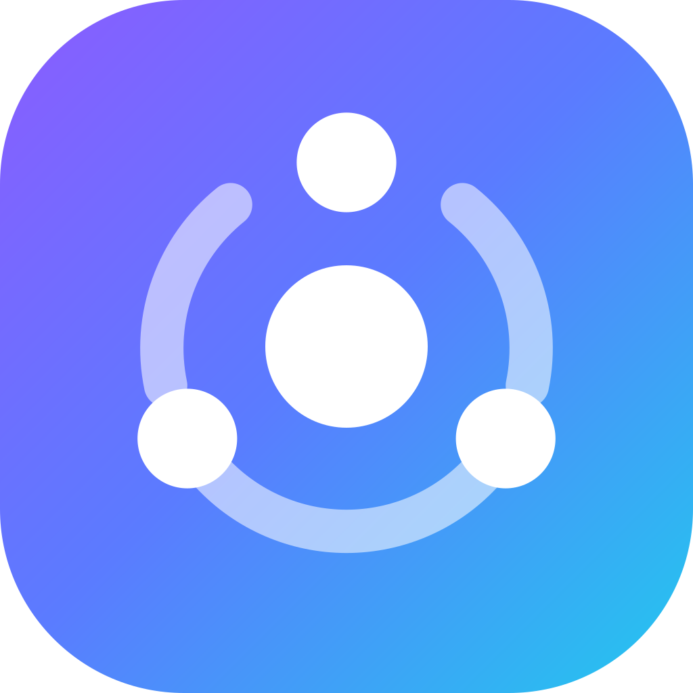
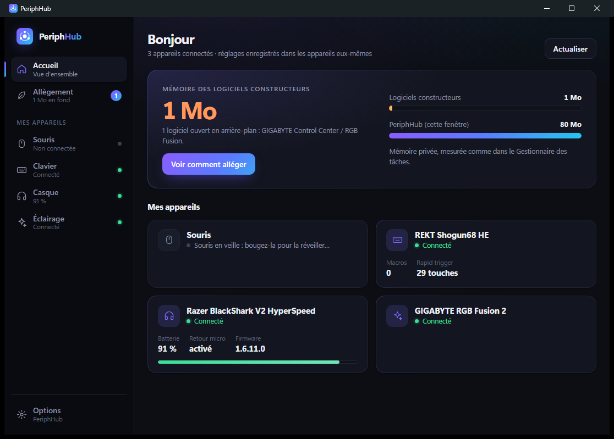
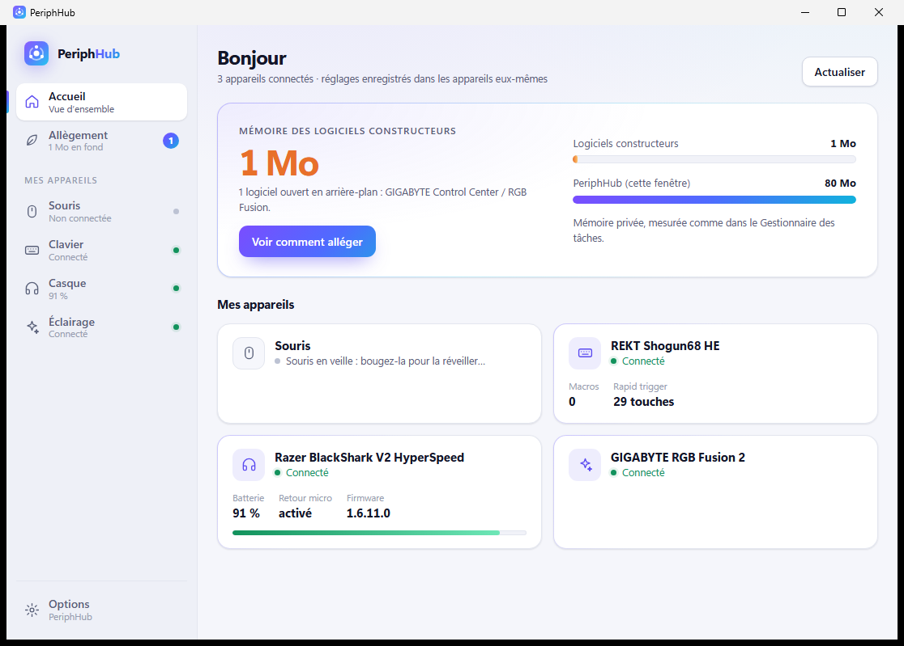
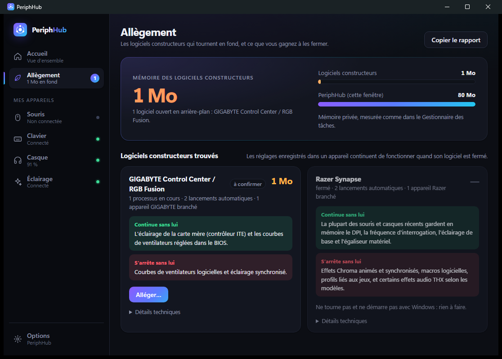

<p align="center">
  
</p>
<h1 align="center">PeriphHub</h1>
<p align="center"><strong>Un seul logiciel léger pour tous vos périphériques.</strong></p>
<p align="center">
  <a href="https://github.com/Sharkytihno/PeriphHub/releases"></a>
  <a href="LICENSE"></a>
  
  <a href="https://github.com/Sharkytihno/PeriphHub/actions/workflows/ci.yml"></a>
</p>

<p align="center">
  
  
</p>

Razer Synapse, Logitech G HUB, Corsair iCUE, SteelSeries GG, Armoury Crate… Chaque marque installe
son logiciel, qui démarre avec Windows et occupe souvent plusieurs centaines de Mo de mémoire vive,
même quand vous ne changez aucun réglage.

PeriphHub vise à les remplacer par une seule petite application :

1. **Analyse** : quels logiciels constructeurs tournent, combien de mémoire ils occupent, ce qui
   démarre avec Windows, et quels périphériques sont branchés.
2. **Centralisation** : les réglages de vos souris, claviers et casques (DPI, éclairage, égaliseur,
   macros…) dans PeriphHub.
3. **Allègement guidé** : une fois vos appareils pris en charge, PeriphHub propose, avec votre
   accord et toujours de façon réversible, d'empêcher les logiciels constructeurs de tourner en
   permanence. Ils restent installés et s'ouvrent à la demande pour les réglages rares.

<p align="center"></p>

## Pris en charge

| Famille | Comment | Réglages | Statut |
|---|---|---|---|
| Souris CompX (Scyrox, VXE, ATK, MCHOSE…) | Protocole observé | DPI, fréquence jusqu'à 8 kHz, boutons, macros, veille | ✅ Scyrox V6 · 🧪 autres |
| Claviers VIA / Vial (Keychron, Akko, NuPhy, REKT…) | Protocole VIA | Éclairage enregistré dans le clavier ; REKT : touches, rapid trigger, macros | ✅ REKT · 🧪 autres |
| Logitech (HID++ 2.0) | D'après Solaar / libratbag | DPI, fréquence, SmartShift, molette, batterie | 🧪 |
| Souris de ~50 marques : Pulsar, Lamzu, WLMouse, Endgame Gear, Finalmouse, ATK, VXE, MCHOSE, G-Wolves, VAXEE, Ninjutso, Glorious, HyperX, Corsair, SteelSeries, ASUS… | Bibliothèque [OpenMouse](https://github.com/OpenMouse-Project/mouse-protocol) (AGPL-3.0) | DPI, fréquence, LOD, Motion Sync, correction d'angle, lissage, anti-rebond, veille, batterie | 🧪 |
| Claviers à effet Hall Wooting (ARM), SteelSeries Apex Pro et Keychron HE ; claviers Razer et Logitech en secours | Bibliothèque OpenMouse (`@openmouse/keyboard-protocol`) | Point d'activation, rapid trigger, fréquence, luminosité (réglages globaux) | 🧪 |
| Razer souris et claviers | D'après OpenRazer | DPI, fréquence, éclairage, batterie | 🧪 |
| Casques Razer Kraken filaires (7.1, V2, Tournament Edition, Ultimate, Kitty V2, Classic) | D'après OpenRazer | Éclairage (fixe, respiration, cycle, éteint) | 🧪 |
| Casques Razer BlackShark V2 HyperSpeed | Protocole observé | Égaliseur, retour micro, veille, THX | ✅ |
| Casques SteelSeries, Corsair, HyperX, Logitech, Audeze, Sony… | [HeadsetControl](https://github.com/Sapd/HeadsetControl) | Batterie, retour micro, égaliseur, extinction auto… | 🧪 |
| RGB carte mère GIGABYTE | Protocole RGB Fusion 2 | Effets, couleurs | ✅ |
| Tout ce que gère OpenRGB (1 000+ appareils) | Serveur SDK d'OpenRGB | Couleur unie | 🧪 |

Les autres appareils branchés sont tout de même **nommés** grâce à une base de plus de 1 700 modèles
(`data/catalog.json`, tirée d'OpenRGB, OpenRazer, libratbag, Solaar, rivalcfg, HeadsetControl et
OpenMouse) : PeriphHub dit honnêtement s'il sait les régler, seulement piloter leur éclairage via
OpenRGB, ou s'ils ont encore besoin de leur logiciel d'origine.

✅ testé sur l'appareil · 🧪 expérimental : écrit à partir de projets libres, à confirmer. Un modèle
fonctionne (ou pas) ? Ouvrez un [ticket « Retour sur un appareil »](https://github.com/Sharkytihno/PeriphHub/issues/new?template=retour-appareil.yml) avec le rapport de la page Allègement.

## État du projet

| Version | Contenu | État |
|---|---|---|
| 0.1 | Analyseur (lecture seule : ne modifie rien) | ✅ |
| 0.2 | Nouvelle interface, premiers appareils réglables : souris Scyrox, clavier REKT (VIA, effet Hall), casque Razer BlackShark V2 HyperSpeed (+ THX), RGB GIGABYTE | ✅ |
| 0.3 | Allègement guidé et réversible (interrupteurs officiels de Windows, services en manuel, tâches), journal d'annulation, ouverture à la demande, gain mesuré | ✅ |
| 0.4 | Pilotes génériques **expérimentaux** : Logitech HID++ 2.0 (DPI, fréquence, molette SmartShift / haute résolution, batterie) et Razer (DPI, fréquence, éclairage, batterie). Page de réglages construite automatiquement, réglages d'origine gardés | ✅ |
| 0.5 | Casques SteelSeries Arctis, Corsair Void / Virtuoso, HyperX Cloud, Logitech G / Astro, Audeze, Sony INZONE… via [HeadsetControl](https://github.com/Sapd/HeadsetControl) : batterie, retour micro, égaliseur, extinction auto, éclairage (**expérimental**) | ✅ |
| 0.6 | Claviers QMK **VIA / Vial** de toutes marques (Keychron, Akko, Epomaker, NuPhy…) : éclairage enregistré dans le clavier ; souris à puce **CompX** (VXE, ATK, MCHOSE…) sur la page souris (**expérimental**) | ✅ |
| 0.7 | Passerelle **OpenRGB** : si OpenRGB tourne (serveur SDK), couleur unie sur tous ses appareils ou appareil par appareil | ✅ |
| 0.8 | Identité visuelle « Orbit » : logo, dégradé iris → cyan, thèmes clair et sombre accordés, animations ; README illustré | ✅ |
| 0.9 | Interface en **anglais** (choix de la langue dans Options, anglais par défaut hors Windows en français) ; signature de l'installeur prête (SignPath Foundation) | ✅ |
| 0.10 | Souris de ~50 marques via **OpenMouse** ; base de 1 400+ appareils nommés avec leur niveau de prise en charge | ✅ |
| 0.11 | Claviers **Wooting** et **SteelSeries Apex Pro** (point d'activation, rapid trigger) via OpenMouse ; 108 casques reconnus (HeadsetControl) | ✅ |
| 0.12 | Éclairage des casques **Razer Kraken** filaires (OpenRazer) ; durcissements de sécurité (outils Windows appelés par chemin absolu, DLL THX verrouillée pendant sa vérification, clés FIDO jamais accessibles) ; paquet Microsoft Store (MSIX) | ✅ |
| 0.13 | **Plus jamais de blocage** : un périphérique USB qui ne répond pas à Windows ne fige plus l'appli ni l'analyse (délais partout, message clair) ; souris **SteelSeries Rival 3** corrigée (bonne interface USB) ; éclairage des claviers **SteelSeries Apex 3 / 3 TKL** ; claviers magnétiques **Keychron HE** (169 modèles) ; bouton **Signaler** qui ouvre un ticket GitHub prérempli avec le diagnostic | 🧪 |
| 1.0 | Pilotes expérimentaux confirmés par les utilisateurs, premier installeur signé | 🗺️ |

Voir la [feuille de route](docs/ROADMAP.md).

## Installer

Téléchargez `PeriphHub_x.y.z_x64-setup.exe` dans les
[Releases](https://github.com/Sharkytihno/PeriphHub/releases). L'installation se fait pour votre
compte seul et ne demande pas de droits administrateur.

L'interface est en français ou en anglais (*English available*) : choix dans **Options ▸ Langue**.

> Tant que l'installeur n'est pas signé, Windows peut afficher « Windows a protégé votre
> ordinateur ». Cliquez sur **Informations complémentaires** puis **Exécuter quand même**.
> La signature (gratuite pour les logiciels libres, par SignPath Foundation) et la façon de vérifier un
> téléchargement sont décrites dans [docs/SIGNATURE.md](docs/SIGNATURE.md).

## Votre appareil ou votre logiciel n'est pas reconnu ?

C'est normal au début, et c'est comme ça que la liste grandit :

1. Dans PeriphHub, cliquez sur **Copier le rapport** (les chemins sont anonymisés).
2. Ouvrez un [ticket « Appareil ou logiciel non reconnu »](https://github.com/Sharkytihno/PeriphHub/issues/new/choose)
   et collez le rapport.

Les données sont dans de simples fichiers JSON :
[`data/vendors.json`](data/vendors.json) (logiciels constructeurs),
[`data/devices.json`](data/devices.json) (appareils pris en charge),
[`data/usb-vendors.json`](data/usb-vendors.json) (fabricants USB). Voir [CONTRIBUTING.md](CONTRIBUTING.md).

## Ce que PeriphHub ne fera jamais

- **Flasher un firmware.** Les mises à jour passent par les outils officiels des fabricants.
- **Toucher aux anti-triche** (Vanguard, FACEIT, EasyAntiCheat…) ni installer de pilote noyau non signé.
- **Envoyer des données** sans action explicite de votre part.

## Compiler

Prérequis : [Rust](https://rustup.rs), Node.js 20+, Visual Studio Build Tools (C++), WebView2 (déjà présent sur Windows 10/11).

```bash
npm install
powershell -File scripts/fetch-headsetcontrol.ps1   # module casques, empreinte vérifiée
npm run dev        # lancement en développement
npm run build      # installeur dans src-tauri/target/release/bundle/nsis/
```

Analyse en ligne de commande, sans fenêtre :

```bash
src-tauri/target/release/periphhub.exe --scan
```

## Licence

[GPL-3.0-or-later](LICENSE). PeriphHub s'appuie sur le travail de la communauté
(OpenRGB, OpenRazer, Solaar, libratbag, HeadsetControl, OpenMouse…) — détail dans [THIRD_PARTY.md](THIRD_PARTY.md) — et en restera un logiciel libre.

Les noms et marques cités appartiennent à leurs propriétaires. PeriphHub n'est affilié à aucun fabricant.
